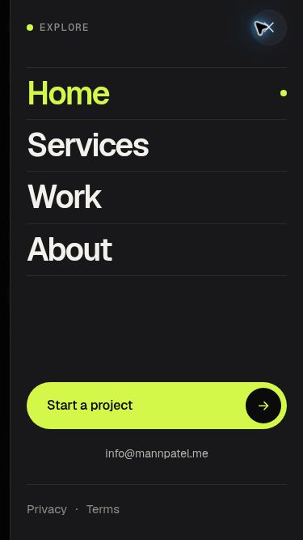

# Mobile navigation simplification

The phone menu now has four primary page links (Home, Services, Work and About), one full-width Start a project action, one email link and small Privacy and Terms links. A right-side drawer, subdued separators and a lime current-page marker establish a clear order. The duplicate Contact destination and the row of social and contact buttons were removed from this drawer.

The native dialog retains modal focus behavior and Escape dismissal. Outside taps close it, focus returns to the menu trigger, the trigger announces its expanded state, and background page scrolling is locked. Drawer movement respects reduced-motion preferences. Safe-area padding and scrolling support landscape screens and enlarged text.

## Verification

- Astro check passed with no errors or warnings; the existing unused-import hint in services.astro remains.
- All 72 Vitest tests passed. The Node build and the 15-page static export passed with no missing internal targets.
- Chrome inspection at 320 × 568, 375 × 667 and 390 × 844 confirmed no menu overflow. Every navigation and contact target is at least 44 pixels tall.
- The open-menu axe scan reported zero violations (25 passes).
- Checked Tab navigation, Escape, backdrop dismissal, focus return, the Services current-page marker, page-link navigation and the Start a project path. At 844 × 390 the panel scrolls to expose its lower links.
- Browser regression assertions now cover the four navigation links, single project action, email destination, expanded state, backdrop dismissal and the current-page marker. The full Playwright suite remains unrun because the environment's browser download was incomplete; the existing shared Chrome provided the manual checks above.

